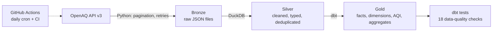

# India Air Quality Data Pipeline


An end-to-end data engineering pipeline that ingests daily air-quality readings for **Mumbai, Delhi, Bangalore, Hyderabad and Kolkata** from the OpenAQ API, models them with dbt, and computes the **Indian AQI (CPCB method)**. It runs daily on GitHub Actions.

## Architecture



| Layer | What it holds | Built with |
|---|---|---|
| Bronze | API responses stored as received | Python, JSON |
| Silver | Typed, deduplicated daily readings | DuckDB SQL |
| Gold | `fct_daily_readings`, `fct_daily_aqi`, `dim_city`, `dim_station`, `dim_pollutant`, city daily and monthly aggregates | dbt |

## Key numbers

- 370K+ daily readings from 556 sensors at 40 active stations, with history back to 2016
- 6 pollutants (PM2.5, PM10, NO2, SO2, CO, O3) plus temperature and humidity
- 18 automated dbt tests (not-null, unique, relationships, accepted values, valid ranges, stale-station warning)

## Results: average AQI by city (all history)

| City | Avg AQI | Days with data |
|---|---|---|
| Delhi | 221 | 10,575 |
| Mumbai | 132 | 7,706 |
| Kolkata | 113 | 9,763 |
| Hyderabad | 86 | 7,363 |
| Bangalore | 72 | 9,510 |

Delhi's average falls in the CPCB "Poor" band, while Bangalore's is "Satisfactory".

## Design decisions

- **Idempotent loads:** readings are keyed by sensor and day, so re-running the pipeline never creates duplicates.
- **Unit standardisation:** gases arrive in both ppb and µg/m³. dbt converts everything to one unit before AQI is calculated.
- **Data quality:** negative sensor values are removed, low-coverage days (under 66%) are excluded from AQI, and stations that stop reporting raise a test warning.
- **Station selection:** only stations active in the last 7 days are ingested (up to 8 per city), to respect API rate limits.
- **Secrets:** the API key lives in `.env` locally and in a GitHub Actions secret in CI. It is never committed.
- **Why DuckDB:** a whole warehouse in one file, with no server, ideal for a lightweight, reproducible project.

## Known limitations

- AQI uses daily averages for all pollutants. The official method uses 8-hour maximums for CO and O3.
- Station coverage varies by city and over time, so some days have gaps.
- The API date filter was not honoured, so each run re-fetches the full history. Results stay correct because of idempotent loads.

## Run it yourself

1. Get a free API key at [explore.openaq.org](https://explore.openaq.org/register).
2. Set up:
   ```
   git clone https://github.com/abhimannyu22/india-air-quality-pipeline.git
   cd india-air-quality-pipeline
   python -m venv .venv
   .venv\Scripts\activate
   pip install -r requirements.txt
   mkdir data
   ```
3. Create a `.env` file containing `OPENAQ_API_KEY=your_key`.
4. Run the pipeline:
   ```
   python src/fetch_locations.py
   python src/select_stations.py
   python src/fetch_measurements.py
   python src/load_duckdb.py
   cd dbt_project
   dbt seed
   dbt run
   dbt test
   ```

## Tech stack

Python, SQL, DuckDB, dbt (dbt-duckdb), GitHub Actions, Git, OpenAQ REST API

## Roadmap

Dagster orchestration, Streamlit dashboard, Dockerfile, cloud deployment.